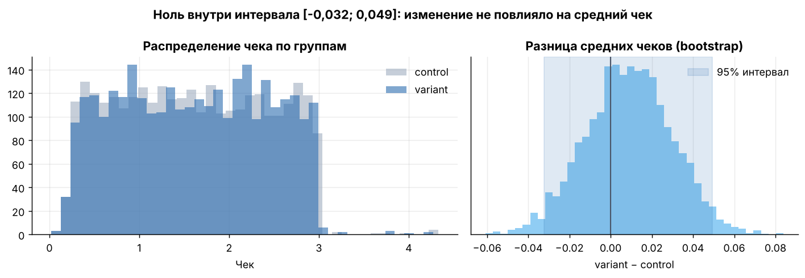
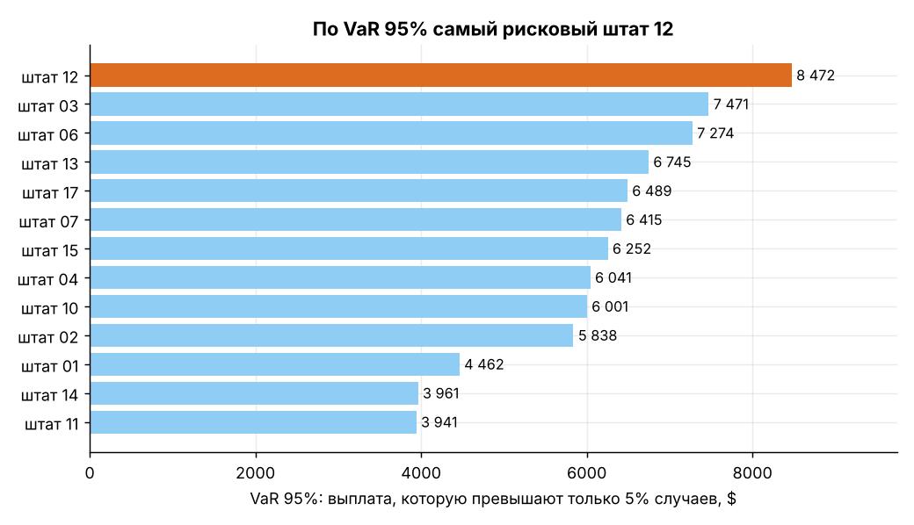
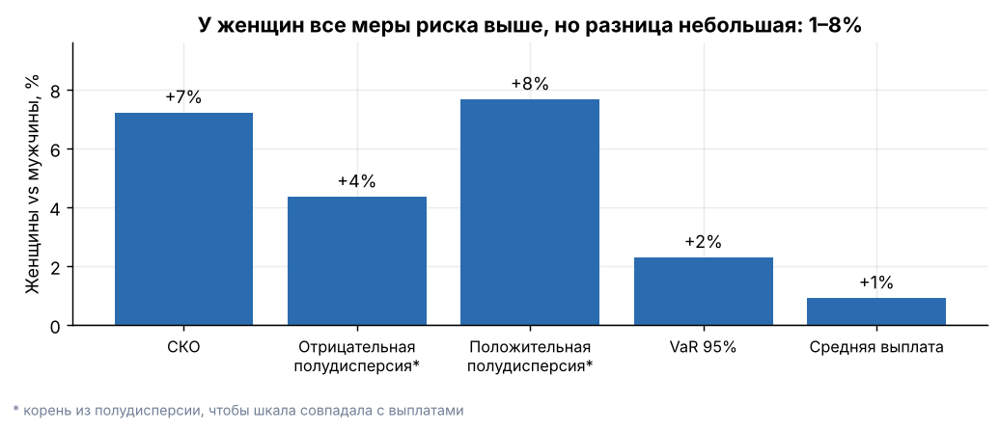

# Статистика для бизнеса: два небольших проекта

Учебные задачи с 3 курса СПбГЭУ, на которых я отрабатывал A/B-тесты и оценку риска.

[English version below](#english)

## 1. A/B-тест: повлияло ли изменение на средний чек

[Ноутбук](ab-test-average-check/ab_test_average_check.ipynb) · 10 тыс. заказов, группы `control` и `variant`.

Сначала проверил, что тесту можно доверять: группы примерно равны, дубликаты удалены, а пользователи, попавшие в обе группы, исключены. Это частая ошибка, и её важно найти до того, как считать метрики. Потом убрал выбросы по правилу 1,5 IQR и посчитал метрики:

| Группа | Заказы | Пользователи | ARPU | Средний чек |
|---|---|---|---|---|
| control | 3 005 | 2 379 | 2,02 | 1,60 |
| variant | 3 026 | 2 387 | 2,04 | 1,61 |

**Вывод: изменение на средний чек не повлияло.** t-тест даёт p = 0,67. Bootstrap-интервал для разницы средних чеков содержит ноль: от −0,03 до +0,05, то есть возможный эффект в пределах ±3%. Раскатывать изменение ради роста чека нет смысла.

## 2. Меры риска в автостраховании

[Ноутбук](insurance-risk-measures/insurance_risk_measures.ipynb) · 6 773 страховые выплаты: штат, рисковый класс, пол, возраст, сумма.

Задача: понять, какие группы клиентов самые рисковые для страховщика и какой мерой риска пользоваться. Посчитал дисперсию, СКО, положительную и отрицательную полудисперсию (своей функцией, в библиотеках её нет), максимальный ущерб и VaR 95% по полу и по штатам.

**Вывод 1: выбор меры риска меняет ответ.** По дисперсии и СКО «лидирует» штат 07, но только из-за единичных огромных выплат: там максимальная выплата 60 тыс. $. По VaR 95%, то есть по уровню выплаты, который превышают лишь 5% случаев, самый рисковый штат 12, а 07 в середине списка. Для страховщика VaR полезнее: он устойчив к единичным выбросам и прямо отвечает на вопрос, к каким выплатам надо быть готовым.

**Вывод 2: пол почти не влияет.** У женщин все меры риска выше, но разница всего 1–8%, а средняя выплата отличается на 1%. Для тарифа пол слабый фактор, штат важнее.

## Файлы

`scripts/make_figures.py` строит графики для этого README. Данные лежат в папках `data/` внутри каждого проекта.

Python, pandas, NumPy, SciPy, matplotlib.

---

## English

**A/B test on average order value.** After validating the split (balance, duplicates, users exposed to both variants) and removing outliers, there is no effect: p = 0.67, and the bootstrap 95% CI for the difference is −0.03 to +0.05.

**Risk measures in car insurance (6,773 claims).** The choice of risk measure changes the answer. Variance points to state 07, but only because of a few extreme claims, while VaR 95% points to state 12, which makes VaR the better measure for an insurer. Differences by gender are small (1–8%).
